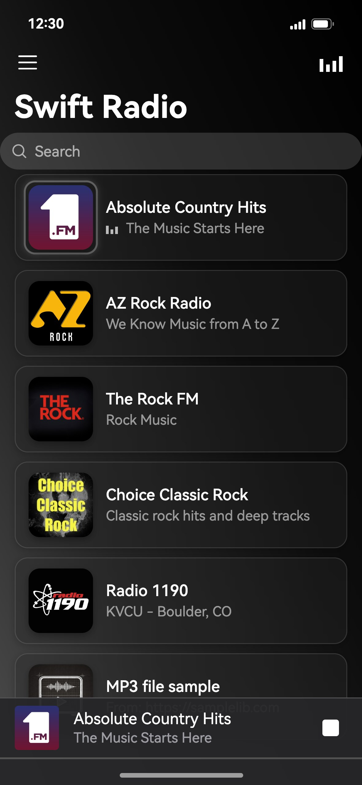
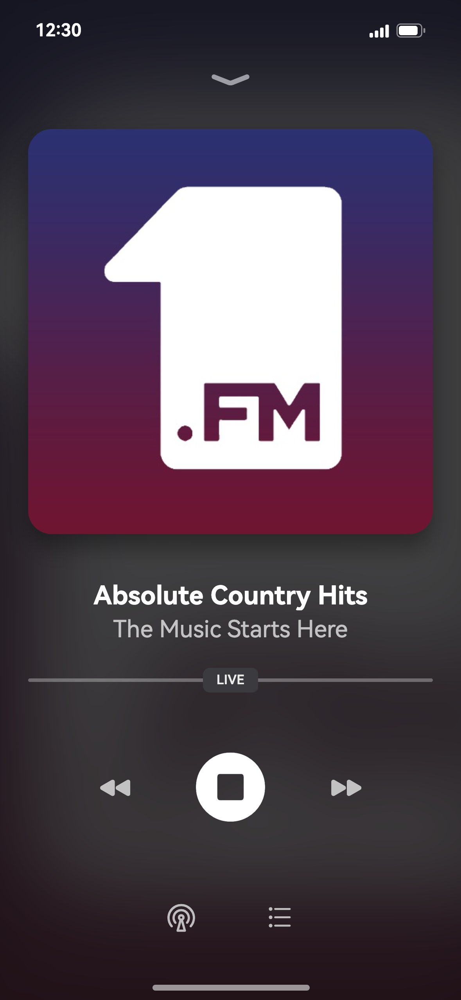
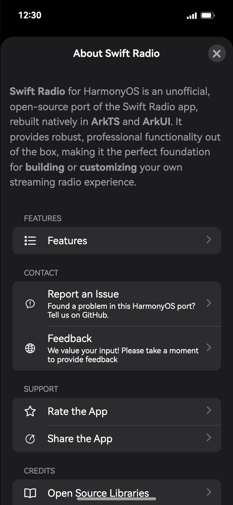
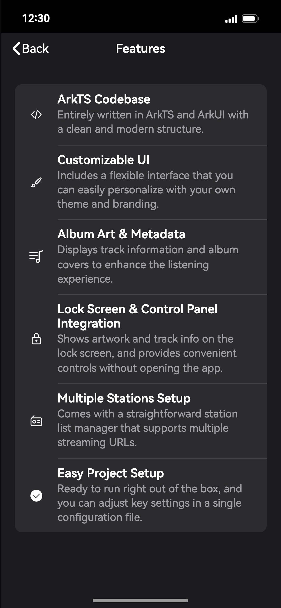

<p align="center"></p>
<h2 align="center"><b>Swift Radio</b></h2>
<h4 align="center">The open-source radio station app for iOS, rebuilt natively for HarmonyOS.</h4>

<p align="center"></p>

> ### Please read this first
>
> This is an unofficial community port. It is not affiliated with, endorsed by, or supported by
> Matthew Fecher, Fethi El Hassasna, or the Swift Radio project. If something here is broken, it is
> broken here. Do not open an issue upstream for it.
>
> The name Swift Radio and the app icon belong to the Swift Radio authors. The MIT License covers
> the source code, not the name and not the artwork. Both are used here only to say what this is a
> port of, and both will change if the upstream authors would rather we did not use them.

<p align="center"><a href="#screenshots">Screenshots</a> &bull; <a href="#install">Install</a> &bull; <a href="#known-limits">Known limits</a> &bull; <a href="#license">License</a></p>

<hr>

Swift Radio is an open-source internet radio app for iOS, written by Matthew Fecher, Fethi El
Hassasna and the Swift Radio contributors. This repository is the iPhone app rewritten for HarmonyOS
in ArkTS, against ArkUI. It reads the same station list format, shows track titles and album art
while a station plays, and keeps playing in the background with lock screen and Control Panel
controls.

Upstream lives at [analogcode/Swift-Radio-Pro](https://github.com/analogcode/Swift-Radio-Pro).
This port is based on Swift Radio for iOS 3.1.0 (upstream tag
[`v3.1.0`](https://github.com/analogcode/Swift-Radio-Pro/tree/v3.1.0)). If you are on an iPhone, go
there instead. This port exists for people whose phone runs HarmonyOS and who want Swift Radio on
it.

## Screenshots

<p align="center">




</p>

These pictures were drawn from the app's source code: its layouts, texts and station list, with the
HarmonyOS system font and icons. They were not captured on a phone, so spacing can differ slightly
from a device.

## Install

There is no prebuilt package here. You build it and sign it yourself, which also means the package
carries your certificate and your device list rather than someone else's.

You need DevEco Studio 6.x with the HarmonyOS SDK 6.1.1 (API 24), a HarmonyOS developer account, and
a device running HarmonyOS.

1. Clone this repository and open the folder in DevEco Studio.
2. Go to **File > Project Structure > Signing Configs**. Sign in, connect the device, and let DevEco
   generate a signature. The bundle name is `com.etspworks.SwiftRadio.hmos`.
3. Build it: **Build > Build Hap(s)/APP(s) > Build Hap(s)**. The package lands in
   `entry/build/default/outputs/default/`.
4. Install and launch it:

```bash
hdc install -r entry-default-signed.hap
hdc shell aa start -a EntryAbility -b com.etspworks.SwiftRadio.hmos
```

A generated debug signature only installs on the devices registered to it, and it expires. When it
does, open the same dialog and generate it again.

## Known limits

- AirPlay does not exist here. It is an Apple protocol, so the route button opens the HarmonyOS cast
  picker instead.
- CarPlay does not exist here. It is an Apple service.
- Track titles arrive up to 30 seconds late. AVPlayer on HarmonyOS does not expose stream metadata,
  so the app reads it over a short second connection every 30 seconds.
- Rate the App shows a notice instead of a store page. The port has no store listing yet.

## License

MIT, the same as upstream. `LICENSE` is the upstream file, unchanged:

```
Copyright (c) 2015 Matthew Fecher
```

Everything written for HarmonyOS is released under those same terms. `NOTICE` lists what came over
from upstream and the example radio stations, whose names, logos and streams belong to their
broadcasters.
